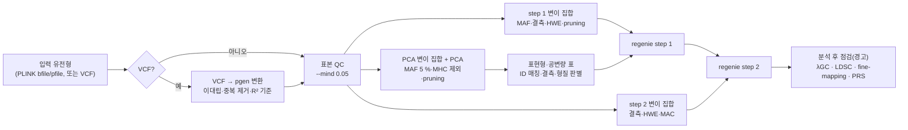

# GWAS 품질 관리(QC) — 기준, 방법, 이번 데이터에서의 효과

> 작성 2026-10-29 · 대상 코드: [`src/samkit/steps/gwas.py`](../src/samkit/steps/gwas.py)(`DEFAULTS`, `ensure_qc`, `build_pheno_table`, `convert_vcf`),
> 분석 후 점검은 `plots.py`·`finemap.py`·`ldsc.py`·`prs.py`.
> 관련 문서: [WORKFLOW.md](WORKFLOW.md) 2.5절(단계 설명), [DESIGN.md](DESIGN.md) 3절(기본값의 근거), [EXPERT-INPUT.md](EXPERT-INPUT.md)(전문가 판단이 필요한 항목),
> [REVIEW-2026-10-27.md](REVIEW-2026-10-27.md) O1.
> 수치는 벤치마크 정답 실행(`output/bench/reference/output/`, KBA v2.0 AB 14K, HDL)의 기록입니다. 개인 단위 값은 싣지 않습니다.

## 1. 요약

- QC는 GWAS를 돌릴 때마다 항상 실행됩니다(`sam_gwas` `stage=prepare` 또는 `all`). 하네스가 plink2로 표본 QC와 세 가지 변이 집합(step 1 모형 적합용, PCA용, step 2 검정용)을 만듭니다.
- **이번 KBA 14K 데이터에서는 검정 대상 표본과 변이가 하나도 제거되지 않았습니다.** 입력이 제공처에서 이미 QC(2차 SNP QC, 상염색체만, MAF ≥ 1 %)를 거친 파일이라
  하네스 기준으로 더 걸러질 것이 없었습니다. 실제 효과는 step 1 모형 적합용 집합과 PCA용 집합을 고르는 데에만 있었습니다.
- 표현형 표 점검과 분석 후 점검(λGC, LDSC 절편·z, fine-mapping LD 일치, PRS 매칭률 등)은 걸러내지 않고 **경고만** 냅니다.
- 친족 추정·제거, 이형접합도 이상값, 성별 확인, 조상 이상값, MHC 외 장거리 LD 구간 제외, X 염색체, 표현형 변환은 **구현되어 있지 않습니다**.
- QC 기준은 코드에 고정되어 있고, 에이전트 도구나 CLI로 바꿀 수 없습니다(VCF의 임퓨테이션 R² 기준만 CLI에서 지정 가능).

## 2. QC가 실행되는 곳

- **실행 단계**: `gwas prepare`(에이전트 도구 `sam_gwas`의 `stage=prepare`, CLI `./sam gwas prepare --pheno … --pheno-file …`).
  `stage=all`이면 prepare → step1 → step2를 차례로 실행합니다.
- **빠른 실패**: 오래 걸리는 QC 전에 표현형 파일의 헤더(ID 열, 표현형 열, 공변량 열)부터 검사합니다.
- **저장 위치**: 유전형 파일셋마다 `output/gwas/_qc/<유전형>/`.

  | 파일 | 내용 |
  |---|---|
  | `samples_qc.id` | 표본 QC를 통과한 표본(이후 모든 단계의 `--keep`) |
  | `step1.prune.in` / `.prune.out` | step 1 변이 집합 / pruning으로 빠진 변이 |
  | `pca_exclude.bed`, `pca_prune.prune.in`, `pca.eigenvec`, `pca.eigenval` | PCA 제외 구간, PCA 변이 집합, PC 값, 고유값 |
  | `step2.snplist` | step 2 검정 대상 변이 |
  | `*.log` | 각 plink2 실행의 로그(제거 수) |
  | `qc_settings.json` | 이 QC를 만든 기준값과 유전형 경로 |

- **재사용과 무효화**: 같은 유전형으로 다른 표현형을 분석하면 QC 결과를 다시 씁니다. 기준값이나 유전형 경로가 `qc_settings.json`과 다르면 QC 파일을 지우고 다시 만듭니다.
  표현형 표와 QC 설정의 지문(`setup.json`의 `fingerprint`)이 바뀌면 그 표현형의 이전 step 1·step 2 결과, 그림, LDSC, locus 결과를 지워 섞이지 않게 합니다.

## 3. 유전형 QC 기준

기본값은 [`gwas.py`의 `DEFAULTS`](../src/samkit/steps/gwas.py)에 있고, 실행할 때마다 `output/manifest.jsonl`과 단계 로그에 기록됩니다.

| 집합 | plink2 옵션 | 기준(뜻) | 용도 | 근거([DESIGN.md](DESIGN.md) 3절) |
|---|---|---|---|---|
| 표본 QC | `--mind 0.05 --write-samples` | 표본 결측률 ≤ 5 %(call rate ≥ 95 %) | 이후 모든 집합과 표현형 표의 표본 | 이전 구현에는 표본 QC가 없었음(I-13) |
| step 1 변이 | `--keep … --maf 0.01 --geno 0.01 --hwe 1e-6 0 --indep-pairwise 1000 100 0.9` | MAF ≥ 1 %, 변이 결측률 ≤ 1 %, HWE p ≥ 10⁻⁶(고정), LD pruning(창 1000 변이, 이동 100, r² < 0.9) | regenie step 1(전체 유전체 ridge 회귀로 다유전자 예측값 계산) | regenie 권장(MAF > 1 %, 고품질 변이). 이전 MAF 0.1은 지나치게 엄격 |
| PCA 변이 | `--keep … --autosome --exclude bed1 pca_exclude.bed --maf 0.05 --geno 0.01 --hwe 1e-6 0 --indep-pairwise 50 5 0.2` | 상염색체, MHC(chr6:25–34 Mb) 제외, MAF ≥ 5 %, 결측 ≤ 1 %, HWE 10⁻⁶, 엄격한 pruning(창 50, 이동 5, r² < 0.2) | PCA | 이전에는 r² < 0.9 집합으로 PCA(I-14) |
| PCA | `--keep … --extract pca_prune.prune.in --pca 10`(QC 표본 > 50,000이면 `approx`) | PC 10개 계산, 기본 4개를 공변량으로 사용(`n_pc`로 변경 가능, 최대 10) | 집단 구조 보정 | 워크숍과 같음 |
| step 2 변이 | `--keep … --geno 0.05 --hwe 1e-5 0.001 midp --mac 20 --write-snplist` | 변이 결측 ≤ 5 %, HWE(표본 크기 보정형, mid-p), MAC ≥ 20 | regenie step 2 연관 검정 대상 | plink2 a7.8은 큰 표본에 고정 HWE를 거부함. 연관 신호는 지우지 않고 심한 이탈만 제거 |

- **HWE 기준이 두 가지인 이유**: plink2 `--hwe 
 <k>`의 임계값은 p·10^(−n·k)입니다(코드 주석). step 1과 PCA 집합은 `k = 0`인 고정 임계값으로 모형 적합과 PCA에 쓸 변이를 깨끗하게 고릅니다.
  검정 대상(step 2)은 표본 크기에 따라 임계값이 더 작아지는 형태라, 실제 연관 때문에 생긴 이탈은 남기고 유전형 오류의 흔적인 심한 이탈(이형접합 과잉·결핍 모두)만 제거합니다.
- **MAC 20의 크기**: N = 14,490에서 MAF 약 0.07 %(20 / 28,980)에 해당합니다. step 2에는 MAF 하한이 따로 없습니다.
- **친족과 집단 구조**: 친족을 제거하지 않습니다. 연관 검정에서는 regenie step 1의 다유전자 예측값(LOCO)이 친족과 집단 구조를 보정하므로 친족이 남아 있어도 됩니다.
  다만 PCA는 친족을 포함한 전체 표본으로 계산합니다(5절, [EXPERT-INPUT.md](EXPERT-INPUT.md) E1).

## 4. VCF(임퓨테이션) 입력일 때

PLINK 파일이 없고 VCF만 있으면 먼저 `output/genotype/<이름>.{pgen,pvar,psam}`으로 변환합니다(`convert_vcf`).

| 처리 | plink2 옵션 | 이유 |
|---|---|---|
| dosage 유지 | `dosage=DS`(VCF에 FORMAT/DS가 있을 때) | 임퓨테이션 불확실성을 검정에 반영 |
| 이대립 변이만 | `--max-alleles 2` | 다대립 변이는 regenie가 처리하지 못함 |
| 중복 ID 제거 | `--rm-dup exclude-all` | 중복 ID는 `--extract`·`--score`를 깨뜨림 |
| 빈 ID 채우기 | `--set-missing-var-ids @:#:$r:$a` | 위치·대립유전자로 ID 부여 |
| 임퓨테이션 품질 | `--extract-if-info R2>=0.8`(INFO/R2가 있을 때) | 기본 R² ≥ 0.8. INFO/R2가 없으면 경고만 하고 거르지 않음 |
| 표본 ID | `--double-id` | FID = IID |

- R² 기준은 CLI `--min-r2`로 바꿀 수 있지만 에이전트 도구(`sam_gwas`)에는 이 옵션이 없습니다.
- 같은 이름의 변환 결과가 이미 있으면 다시 변환하지 않습니다. 이전 변환의 R² 기준이 다르면 경고합니다.
- 변환 뒤에는 3절의 QC가 그대로 적용됩니다.
- 이번 데이터는 PLINK bfile이라 이 단계를 거치지 않았습니다. dosage VCF의 기준(R² 값, MAF와의 조합, 칩 영역 등)은 [EXPERT-INPUT.md](EXPERT-INPUT.md) E7에서 검토 중입니다.

## 5. 표현형·공변량 표의 점검

`build_pheno_table`이 표현형 파일과 유전형 표본을 맞춰 regenie 입력 표(`output/gwas/<표현형>/pheno.tsv`, 개인 단위)를 만듭니다. 걸러내는 것은 결측뿐이고, 나머지는 오류나 경고입니다.

| 점검 | 내용 | 결과 |
|---|---|---|
| ID 열 | FID와 IID가 둘 다 있으면 둘로, 없으면 `IID`/`ID`/`SAMPLE`/`SAMPLE_ID` 열로 맞춤 | ID 열이 없으면 오류 |
| 중복 ID | FID 없이 IID만 있는데 중복이 있으면 | 오류 |
| ID 매칭 | FID까지 맞춰 0명이면 IID로만 다시 맞춤 | 경고 / 0명이면 오류 |
| 결측 표기 | 빈칸, `NA`, `NaN`, `nan`, `.`, `-9` | 결측 처리 |
| 숫자가 아닌 값 | 표현형·공변량 열 | 결측 처리 + 경고(열별 개수) |
| 형질 판별 | 값이 {0,1}의 부분집합이거나 {1,2}면 이진형(bt), 아니면 양적(qt). 1/2는 0/1로 재코딩 | `trait`로 직접 지정 가능 |
| 이진형 값 | bt인데 0/1(1/2) 이외의 값 | 오류 |
| 공변량 | 기본 AGE·SEX(있으면) + 하네스가 계산한 PC 1–4. 표현형 파일의 PC 열은 무시 | AGE/SEX가 없으면 경고 |
| 완전한 표본 | 표현형·공변량이 모두 있는 표본만 분석 | 50명 미만이면 오류, QC 표본의 50 % 미만이면 경고 |
| case 수 | bt에서 case < 100 | 경고 |
| 분포 | qt는 평균, SD, 1·50·99 백분위수를 보고(최솟값·최댓값은 한 사람의 값이라 쓰지 않음) | 보고만 |

- **하지 않는 것**: 표현형 이상값 제거, 변환(역정규 변환 등), 공변량별 이상값 점검. HDL은 원래 값 그대로 분석합니다([EXPERT-INPUT.md](EXPERT-INPUT.md) E8).
- **이진형 검정**: regenie step 2에 `--bt --firth --approx --pThresh 0.01`을 씁니다(희귀 변이·불균형 표본의 편향 보정).
  case/control 사이의 결측률 차이(differential missingness)는 점검하지 않습니다(E10).

## 6. 분석 후 점검 (경고만)

결과를 지우거나 바꾸지 않고, 단계 결과의 `warnings`와 보고서에 남깁니다. 에이전트 규칙([`pi-package/RULES.md`](../pi-package/RULES.md) 7번 "Relay warnings")에 따라 에이전트는 이 경고를 사용자에게 그대로 전합니다.

| 단계 | 조건 | 경고의 뜻 |
|---|---|---|
| `plots`(QQ) | λGC > 1.1 | 집단 구조·친족에 의한 팽창 의심(큰 N의 다유전자 형질일 수도 있음) |
| `peaks` | 유의 수준(5×10⁻⁸)을 넘는 변이가 없음 | 이후 regional plot·fine-mapping은 탐색적 |
| `finemap` | 선두 변이가 유의 수준 미만 | credible set은 탐색적 |
| `finemap` | 결과와 유전형 파일의 대립유전자가 다름 | 그 변이를 빼고 개수 보고(REF/ALT가 뒤바뀐 경우는 부호를 바꿔 사용) |
| `finemap` | `estimate_s_rss` > 0.1 | z-score와 LD가 서로 맞지 않음 → credible set 해석 주의 |
| `finemap` | SuSiE가 수렴하지 않음 / credible set의 최소 \|r\| < 0.5 | 창 크기나 L 조정 필요 / 순도 낮은 집합 |
| `ldsc` | h²가 [0, 1] 밖 | 해석 불가(검정력 부족이나 모형 부적합) |
| `ldsc` | h² z < 4 | LDSC 저자들이 해석하지 말라고 권하는 약한 추정 |
| `ldsc` | 절편 > 1.1 | 집단 구조·숨은 친족에 의한 교란 의심 |
| `ldsc` | 회귀 SNP < 20만 개 / N < 5,000 | 추정이 불안정함 / 이 표본 크기에서는 부정확 |
| `ldsc` | rsID를 위치로만 부여 | h²에는 충분하지만 유전 상관에는 부족 |
| `ldsc` | 이진형인데 유병률 없음 | 관찰 척도 h²(liability 척도가 아님) |
| `prs` | 매칭률 < 50 % | 점수가 가중치 모형의 일부만 반영 |
| `prs` | 항상 | 가중치를 만든 GWAS에 대상 표본이 들어 있으면 성능이 부풀려짐(표본 중복 확인 필요) |
| `prs` | ID 지도 빌드가 분석 빌드와 다름 | 빌드 불일치 |

PRS 대립유전자 맞추기(`match_weights`): 같은 가닥으로 맞는 변이는 그대로 쓰고, 반대 가닥(상보 염기)으로 맞는 변이는 뒤집어 씁니다. 다만 A/T·C/G(모호 SNP)는 가닥을 뒤집어야 맞는 경우 버리고,
같은 가닥으로 맞는 경우에만 쓰며 그 수를 보고합니다. 어느 쪽으로도 맞지 않는 변이는 버립니다([EXPERT-INPUT.md](EXPERT-INPUT.md) E16·E17).

## 7. 이번 데이터에서의 실제 효과 (KBA v2.0 AB 14K, HDL)

### 7.1 입력이 이미 거친 QC

입력 유전형과 함께 있는 PLINK 로그(`sam-data/input/KBAv2.0AB_14K_COMMON.log`)에 제공처의 처리가 남아 있습니다.

| 항목 | 값 |
|---|---|
| 원본 | `/DDATA/14K/KBAv2.0AB/2ndSNPQC/KBAv2.0AB_14K_Autosome_NonAutosome`(제공처의 2차 SNP QC를 거친 파일) |
| 처리 | `--autosome --maf 0.01 --make-bed`(PLINK 1.9) |
| 상염색체 변이 | 1,463,761개 중 1,415,007개 |
| MAF < 1 % 제거 | 539,218개 |
| 결과 | 변이 875,789개 × 14,490명(남 4,768, 여 9,722, 모두 founder), 전체 genotyping rate 99.71 % |

### 7.2 하네스 QC의 단계별 제거 수

| 단계 | 시작 | 제거 | 남음 |
|---|---|---|---|
| 표본 QC(`--mind 0.05`) | 14,490명 | **0명** | 14,490명 |
| step 1: 결측 ≤ 1 % | 875,789 | 67,176 | |
| step 1: HWE 10⁻⁶ / MAF ≥ 1 % | | 0 / 0 | 808,613 |
| step 1: pruning(r² < 0.9) | 808,613 | 202,963 | **605,650** |
| PCA: MHC 제외 | 875,789 | 21,733 | |
| PCA: 결측 ≤ 1 % / HWE / MAF ≥ 5 % | | 65,314 / 0 / 296,866 | 491,876 |
| PCA: pruning(r² < 0.2) | 491,876 | 360,380 | **131,496** |
| step 2: 결측 ≤ 5 % / HWE / MAC ≥ 20 | 875,789 | **0 / 0 / 0** | **875,789**(모두 검정) |

- 검정 대상의 표본과 변이는 QC 전후가 같습니다. 하네스 기준은 제공처의 사전 QC와 같거나 더 느슨해서 다시 걸러질 것이 없었습니다.
- step 1에서 결측 1–5 %인 변이 67,176개가 모형 적합용 집합에서 빠졌습니다. 이 변이들도 step 2에서는 검정됩니다.

### 7.3 표현형 표

| 항목 | 값 |
|---|---|
| 표현형 파일 | `KBAv2.0AB_14K_HDL_fixed.txt`, 159,849행(유전형이 없는 사람 포함) |
| 유전형과 매칭 | 14,490명 전원 |
| 결측으로 빠짐 | 0명 → 분석 14,490명(변이별 N 중앙값 14,453) |
| 형질 | 양적(qt), 공변량 AGE, SEX, PC1–4 |
| HDL 분포 | 평균 55.26, SD 13.86, 1 % 30, 중앙값 54, 99 % 95 |
| 경고 | 없음 |

### 7.4 분석 후 점검 결과

| 단계 | 값 | 경고 |
|---|---|---|
| GWAS | λGC 1.0464, 유의 변이 164개, locus 14개(500 kb), 검정 실패 0 | 없음 |
| PCA 고유값 | 2.75, 2.26, 2.18, 2.11, 2.05, 2.05, 2.05, 2.04, 2.04, 2.04 | PC1 뒤로 거의 평평 → 뚜렷한 집단 구조 없음(해석은 E1·E3) |
| LDSC | h² 0.2647(SE 0.0781, z 3.39), 절편 1.0224(SE 0.0084), 회귀 SNP 197,828개 | **h² z < 4**, **회귀 SNP < 20만** |
| fine-mapping(2번 locus, chr11:116.66 Mb ±500 kb) | 변이 460개, credible set 4개, 수렴, `estimate_s_rss` 0.0055, 대립유전자 불일치 0 | 없음 |
| PRS(HTN 가중치) | 가중치 966,764개 중 184,705개 사용(매칭률 19.1 %), 가닥 뒤집음 34, 불일치 제거 1, 모호 SNP 사용 0 | **매칭률 < 50 %**, **표본 중복 확인** |

λGC와 LDSC 절편이 1에 가까워, 친족을 제거하지 않고 PCA를 전체 표본으로 계산한 것이 결과를 눈에 띄게 부풀리지는 않은 것으로 보입니다.
LDSC 경고 두 가지는 표본 크기(14K)가 작고, 회귀에 쓰인 SNP가 칩 변이 중 LD score 참조와 겹치는 것뿐이라 생긴 것으로 보입니다.

### 7.5 정리

이번 데이터에서 하네스 QC는 사실상 확인 절차였고, 데이터 품질은 제공처의 사전 QC에 기대고 있습니다.
사전 QC를 거치지 않은 데이터(원시 칩 데이터, 임퓨테이션 VCF 등)에서는 3–4절의 기준이 실제로 작동하지만, 8절의 항목은 그때도 빠져 있습니다.

## 8. 구현되지 않은 QC

| 항목 | 현재 | 영향 | 검토 항목 |
|---|---|---|---|
| 친족 추정·제거(KING, IBD) | 없음. 모든 표본을 founder로 처리 | 연관 검정은 regenie가 보정. PCA가 가족 구조를 잡을 수 있고, 친족 쌍이 많으면 PC가 왜곡될 수 있음. 보통은 비친족으로 PCA 후 나머지를 투영 | E1 |
| 장거리 LD 구간 | PCA에서 MHC만 제외(8p23, 17q21 등은 남음) | PC가 특정 구간의 LD를 잡을 수 있음 | E2 |
| PC 개수 | 10개 계산, 4개 사용(고정 기본값) | 구조가 큰 데이터에서는 부족할 수 있음 | E3 |
| 이형접합도 이상값 | 없음 | 표본 오염·품질 이상을 놓칠 수 있음 | E4 |
| 성별 확인 | 없음(X 염색체가 없고, 표현형의 SEX와 `.fam` 성별을 대조하지 않음) | 표본 뒤바뀜을 놓칠 수 있음 | E4 |
| 조상 이상값 | 없음(PCA 이상값 제거 없음) | 다른 조상의 표본이 섞이면 구조 보정 부담 | E4 |
| 중복·쌍둥이 표본 | 없음 | 친족 추정과 함께 다룰 문제 | E1·E4 |
| step 2의 MAF 하한 | MAC ≥ 20만 | 희귀 변이 결과의 해석 기준(이번 입력은 이미 MAF ≥ 1 %) | E5·E6 |
| X 염색체 | 입력이 상염색체뿐이라 분석하지 않음 | X 연관 신호 없음 | E11 |
| 표현형 이상값·변환 | 없음 | 치우친 분포·극단값의 영향 | E8 |
| case/control 결측 차이 | 없음 | 이진형에서 위양성 가능 | E10 |
| 칩 배치(batch) 효과 | 없음 | 배치가 있는 데이터에서 위양성 가능 | — |

이 항목들의 기준(예: 친족 차수 기준, 제외할 장거리 LD 구간 목록, MAC·MAF 기준, dosage VCF 기준)은 분석 정책에 해당하므로
[EXPERT-INPUT.md](EXPERT-INPUT.md)에 질문으로 정리해 두었고, 전문가 결정 뒤에 구현합니다.

## 9. 기준을 바꾸려면

- **현재 방법은 코드 수정뿐입니다.** `gwas.py`의 `DEFAULTS`를 바꾸면 다음 `prepare` 때 `qc_settings.json`이 달라 QC를 다시 만들고, 그 유전형의 표현형 결과도 지문이 바뀌어 다시 계산됩니다.
- `prepare()` 함수에는 기준을 바꾸는 `overrides` 인자가 있지만, CLI와 에이전트 도구 어느 쪽도 이 인자를 넘기지 않습니다.
  분석 설정으로 CLI가 받는 것은 `--min-r2`(VCF), `--covars`, `--n-pc`, `--trait`, `--chroms`이고, 에이전트 도구 `sam_gwas`는 `covariates`, `n_pc`, `trait`, `chromosomes`만 받습니다(나머지 인자는 파일 지정과 단계 선택).
- 바꿀 때 주의할 점:
  - 벤치마크·에이전트 실행 중에는 `src/`를 바꾸지 않습니다([DEVNOTES.md](DEVNOTES.md)).
  - QC 기준이 바뀌면 벤치마크의 정답 실행(`bench/make-reference.sh`)을 다시 만들어야 합니다. 정답 값(λGC, 유의 변이·locus 수, h², credible set)이 QC에 따라 달라지기 때문입니다.
  - 기준을 사용자나 에이전트에게 열어 줄지(예: `sam_gwas`에 `qc` 인자 추가)는 전문가가 기본값을 정한 뒤에 결정합니다.
