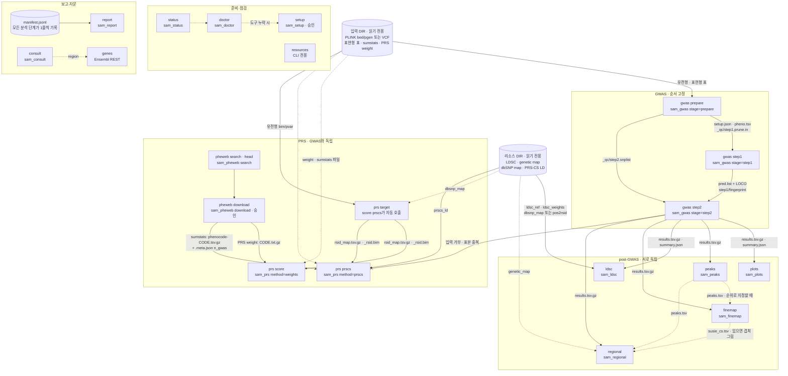

# 워크플로우와 task 설명

이 문서는 지금 구현된 SAM 하네스의 분석 흐름을 **task(단계) 단위**로 설명합니다. 각 task의 역할, 입력·출력,
쓰는 외부 프로그램을 코드 기준으로 정리했습니다. 대상 독자는 하네스를 검토·운영할 KoGES/KBA 팀입니다.

- 기준: 작업 트리의 코드(2026-10-28). 수치·기본값은 모두 코드에서 가져왔고, 소요 시간만 [USAGE.md](USAGE.md) 8절 실측값입니다.
- 설치·모델 연결은 [SETUP.md](SETUP.md), 대화 예시와 문제 해결은 [USAGE.md](USAGE.md), 도구·리소스 출처는 [TOOLS.md](TOOLS.md),
  설계 근거와 이전 구현 문제(I-1~I-28)는 [DESIGN.md](DESIGN.md)를 보세요. 여기서는 반복하지 않습니다.

## 목차

1. [전체 흐름](#1-전체-흐름)
2. [task별 설명](#2-task별-설명) — status, doctor, setup, resources, gwas prepare/step1/step2, plots, peaks, ldsc,
   regional, finemap, pheweb, prs target/score/prscs, genes, report, consult
3. [공통 사항](#3-공통-사항) — 출력 위치, 읽기 전용과 가드, 지문·무효화, 취소
4. [요약표](#4-요약표)

---

## 1. 전체 흐름

### 1.1 개요

| 갈래 | task | 성격 |
|---|---|---|
| 준비·점검 | status → doctor → (setup) | 분석 결과를 만들지 않음. 무엇이 있고 무엇이 빠졌는지 확인 |
| GWAS | gwas prepare → step1 → step2 | **순서 고정**. 앞 단계 출력이 없거나 오래되면 다음 단계가 거부 |
| post-GWAS | plots, peaks, ldsc, regional, finemap | 모두 step2 결과(`results.tsv.gz`)만 있으면 됨. **서로 독립** (단, locus를 순위로 지정하면 peaks 필요, regional은 finemap 결과가 있으면 겹쳐 그림) |
| PRS | pheweb search/download → prs score 또는 prs prscs (prs target은 자동) | **GWAS 갈래와 독립**. 같은 유전형 파일셋을 대상(target)으로 쓸 뿐, 하네스 GWAS 결과는 쓰지 않음 |
| 보고·자문 | report, consult(+genes) | report는 `manifest.jsonl`을 모아 씀. consult는 결과 해석용 2차 의견(곁가지) |

**하네스 자체 GWAS 결과는 PRS-CS 입력으로 쓸 수 없습니다.** `prs prscs`는 입력 경로가 `output/gwas/` 아래이거나
파일 이름이 `results.tsv.gz`이면 거부합니다(발견·대상 표본 중복). 자체 GWAS → PRS 경로(표본 분할 등)는 의도적으로
열지 않았습니다([prs.py](../src/samkit/steps/prs.py) `prs_prscs`, [DESIGN.md](DESIGN.md) 6절).

### 1.2 흐름도

실선은 필수 입력, 점선은 선택 입력 또는 점검 흐름, ×로 끝나는 선은 코드가 막는 경로입니다. 각 상자 안의 두 번째 줄은 에이전트 도구 이름입니다.



### 1.3 의존 관계

| task | 반드시 먼저 있어야 하는 것 | 선택적으로 쓰는 것 | 이 task 결과를 쓰는 task |
|---|---|---|---|
| gwas prepare | 유전형 파일셋(또는 `--vcf`), 표현형 표 | — | step1, step2, regional·finemap(표본 목록) |
| gwas step1 | prepare의 `setup.json`, `pheno.tsv` | — | step2 |
| gwas step2 | step1 `*_pred.list` (**같은 지문**) | — | plots, peaks, ldsc, regional, finemap |
| plots, peaks, ldsc | step2 결과 | — | peaks → regional/finemap(순위 지정 시) |
| regional | step2 결과 | peaks(순위), finemap(CS), genetic_map, Ensembl | — |
| finemap | step2 결과 | peaks(순위), genetic_map, Ensembl | regional(CS 겹치기) |
| pheweb download | pheweb 목록(search 또는 자동 조회) | — | prs score, prs prscs |
| prs target | 유전형 bim/pvar + (rsID가 아니면) dbsnp_map | — | prs score, prs prscs |
| prs score | weight 파일 | — | — |
| prs prscs | **외부** sumstats, n_gwas, prscs_ld | — | — |
| report | `manifest.jsonl` | — | — |

### 1.4 실행 방식 (모든 task 공통)

```
에이전트 도구 sam_*  ──(runner.ts)──▶  python -m samkit [--input --resource --output --build --threads] <명령> ...
./sam run <명령> ...  ──(core())────▶  같은 명령 (전역 옵션은 어디에 써도 앞으로 옮겨짐)
```

- 에이전트 도구는 [index.ts](../pi-package/extensions/sam/index.ts)에, 하위 프로세스 실행은 [runner.ts](../pi-package/extensions/sam/runner.ts)에 있습니다.
  같은 분석을 `./sam run ...`으로 에이전트 없이 재현할 수 있습니다([sam](../sam) `core()`).
  `status`, `doctor`, `resources`, `report`는 `run` 없이 `./sam status ...`처럼도 부를 수 있고, `setup`은 `./sam setup ...`입니다.
- stdout에는 JSON 하나만 나옵니다. 분석 단계(`StepRun`, [steps/\_\_init\_\_.py](../src/samkit/steps/__init__.py))의 결과는 항상
  `ok, step, key, summary, outputs, warnings, next, log, seconds, tools` 형태입니다. 실패는 `{"ok": false, "error", "hint"}`.
- **개인정보 설계**: 모든 task는 집계값만 돌려줍니다(표본 수, 분위수, 통계량, 파일 경로). 개인 단위 값(표현형, PC, 개인별 점수)은
  파일로만 남고 JSON에 들어가지 않습니다. 모델에 보내는 텍스트는 `tools` 필드를 빼고 14,000자에서 자릅니다.
- 그림이 있는 task(plots, ldsc, regional, finemap)는 모델이 이미지를 받을 수 있으면 PNG를 최대 2장(각 3 MB 미만) 함께 보냅니다.
- 분석 도구는 `executionMode: "sequential"`이라 한 번에 하나씩 실행됩니다(출력 폴더·CPU 공유). `sam_status`, `sam_doctor`, `sam_consult`는 예외.
- 스레드: `--threads`(기본 `min(CPU 수, 16)`), 외부 도구에는 `--threads`와 `OMP/MKL/OPENBLAS_NUM_THREADS`로 전달됩니다.

외부 도구 버전(모두 `pixi.lock` 고정, [TOOLS.md](TOOLS.md) 1절):

| 도구 | 버전 | pixi 환경 | 쓰는 task |
|---|---|---|---|
| PLINK 2 | 2.0.0a.7.8 | `default` | gwas prepare(+VCF 변환), regional, finemap, prs score/prscs |
| regenie | 4.1.3.1 | `regenie` | gwas step1, step2 |
| R + susieR (+ jsonlite) | R 4.5.3, susieR 0.14.2, jsonlite 2.0.0 | `default` | finemap |
| ldsc (Python 3 포팅) | 2.0.1 (Python 3.10, numpy 1.26, pandas 1.5, scipy 1.11) | `ldsc` | ldsc |
| PRS-CS | 1.1.0 (Python 3.10, numpy 1.26, scipy 1.11, h5py 3.16) | `prscs` | prs prscs |
| Python + numpy/pandas/scipy/matplotlib/requests | 3.12, 2.5 / 2.3 / 1.18 / 3.11 / 2.34 | `default` | samkit 전체(표 처리, 그림, HTTP) |
| pixi | 0.81.0 | `.sam/bin` | setup |
| 네트워크 | KNIH PheWeb HTTP, Ensembl REST | — | pheweb, regional/finemap 유전자 트랙, genes |

---

## 2. task별 설명

각 task는 같은 순서로 적었습니다: **역할/목적 · 실행 · 입력 · 출력 · 외부 도구 · 전제조건/주의**.
경로의 `<p>`는 표현형 이름(파일명에 안전한 문자로 바꾼 것), `<g>`는 유전형 파일셋 이름입니다.

### 2.1 status — 무엇이 있는가

**역할/목적**: 세션 시작 시 입력·리소스·설치 도구·완료 단계를 한 번에 보여줍니다. 모델이 표현형 파일과 열을 고를 근거가 됩니다.
출력 폴더를 이 입력/리소스/빌드에 묶는(`sam.json`) 첫 호출이기도 합니다.

| 실행 | |
|---|---|
| 에이전트 | `sam_status` (파라미터 없음) |
| CLI | `./sam status --input DIR --resource DIR` |

- **입력**: 입력 폴더(깊이 2까지), `output/genotype/`, `output/downloads/`, 리소스 폴더(폴더·압축), `manifest.jsonl`.
- **출력**: 파일 없음(`sam.json`만 생성/확인). JSON 필드:
  - `input.genotypes`: 파일셋 이름, 형식(bfile/pfile/vcf/bgen), 변이 수, 표본 수, 위치(input/output)
  - `input.tables`: 표마다 `kind`(phenotype / sumstats / prs_weight / id_map / other), **열 이름과 행 수만**. 헤더가 없는 표는 첫 줄이
    한 사람의 기록일 수 있어 내용을 숨김. 표현형 표에는 `individual_level: true`
  - `resources.components`: 인식된 리소스(2.4절 kind), 염색체, `complete_autosomes`
  - `completed_steps`(manifest 기준), `tools_installed`, `build`, `threads`
- **외부 도구**: 없음([inventory.py](../src/samkit/inventory.py), [resources.py](../src/samkit/resources.py)).
- **주의**: 입력 폴더가 필요합니다. 출력 폴더가 다른 데이터에 묶여 있으면 거부합니다(3.3절).

### 2.2 doctor — 이 단계를 돌릴 수 있는가

**역할/목적**: 지정한 단계에 필요한 도구와 리소스**만** 점검합니다("필요한 것만 확인"). 모자라면 어느 pixi 환경을 설치해야 하는지 알려줍니다.

| 실행 | |
|---|---|
| 에이전트 | `sam_doctor` `steps: ["gwas", ...]` |
| CLI | `./sam doctor --step ldsc [--step ...] [--resource DIR]` (입력 폴더 없이 동작) |

- **입력**: pixi 환경의 도구 경로(`SAM_TOOL_<NAME>`으로 덮어쓰기 가능), 리소스 폴더.
- **출력**: 단계별 `ready`, `tools`(버전 또는 `missing`), `resources`(kind, required, 찾은 것 최대 3개), `install_env`.

  | 단계 | 점검 도구 ([tools.py](../src/samkit/tools.py) `STEP_TOOLS`) | 점검 리소스 ([cli.py](../src/samkit/cli.py) `STEP_RESOURCES`) |
  |---|---|---|
  | gwas | plink2, regenie, python | — |
  | plots, peaks, pheweb | python | — |
  | ldsc | python, ldsc-python, ldsc, munge_sumstats | ldsc_ref·ldsc_weights·(dbsnp_map 또는 pos2rsid) 필수 |
  | regional | plink2, python | genetic_map 선택 |
  | finemap | plink2, Rscript, python | — |
  | prs | plink2, python, prscs-python, prscs | dbsnp_map·prscs_ld 선택 |

- **외부 도구**: 각 도구의 `--version`(plink2, regenie) 또는 conda 메타데이터(R/susieR, PRS-CS, Python), ldsc dist-info.
- **주의**: `prs`는 weights 경로만 쓸 때도 PRS-CS 도구를 점검하므로 `prscs` 환경이 없으면 `ready: false`가 됩니다.
  에이전트의 `sam_doctor`는 입력 폴더가 지정되어 있어야 호출됩니다(CLI는 불필요).

### 2.3 setup — 분석 환경 설치

**역할/목적**: 단계에 필요한 pixi 환경만 하네스 폴더 안(`.pixi/envs/`)에 설치합니다. sudo, 전역 설치 없음.

| 실행 | |
|---|---|
| 에이전트 | `sam_setup` `steps: [...]` — **사용자 승인 창** (`--approvals allow`면 묻지 않음, `deny`이거나 화면 없는 실행의 `ask`면 거부) |
| CLI | `./sam setup --step ldsc` 또는 `./sam setup --env default,regenie` (아무것도 안 주면 default, regenie, ldsc) |

- **입력**: [pixi.toml](../pixi.toml), `pixi.lock`, `.sam/bin/pixi`(`./sam bootstrap`이 설치).
- **출력**: `.pixi/envs/<env>/`. JSON: `installed_envs`. 단계→환경: gwas → default+regenie, ldsc → default+ldsc, prs → default+prscs, 나머지 → default.
- **외부 도구**: pixi 0.81.0 (`pixi install --manifest-path pixi.toml -e <env>`), 네트워크(conda-forge, bioconda, PyPI).
- **주의**: 에이전트가 bash로 pip/conda/apt/npm/git clone을 하는 것은 가드가 막습니다. 설치는 이 경로로만.

### 2.4 resources — 참조 리소스 인식·추출 (CLI 전용)

**역할/목적**: 리소스 폴더에서 이름 규칙으로 구성요소를 찾고, 압축 파일은 풀지 않고 목록만 읽습니다. 단계가 필요로 할 때
**필요한 파일만** 출력 캐시에 추출합니다. 다른 task(ldsc, regional, prs)가 내부에서 같은 코드를 씁니다. 에이전트 도구는 없습니다.

| 실행 | |
|---|---|
| CLI | `./sam resources --input DIR --resource DIR` (목록) / `--prepare <kind>` (미리 추출) |

| kind | 인식 규칙 ([resources.py](../src/samkit/resources.py)) | 쓰는 task |
|---|---|---|
| `ldsc_ref` | `<dir>/<stem>.{1..22}.l2.ldscore.gz` (+`.l2.M_5_50`) | ldsc |
| `ldsc_weights` | 위와 같은 형식, 경로에 `weight` | ldsc |
| `hm3_snplist` | `w_hm3*.snplist` | (인식만, 현재 사용 안 함) |
| `pos2rsid` | `pos2rsid*.txt[.gz]` | ldsc (대체 경로) |
| `dbsnp_map` | 이름에 `dbsnp`와 `rs`가 있는 `.txt/.tsv[.gz]` 2열 표 | ldsc, prs target |
| `genetic_map` | `plink.chr{N}.GRCh37.map` / `GRCh38` | regional, finemap 그림 |
| `prscs_ld` | `ldblk_{1kg\|ukbb}_{pop}/ldblk_*_chr{N}.hdf5` + `snpinfo_*` | prs prscs |

- **입력**: 리소스 폴더(일반 파일 깊이 ≤ 4, `.zip/.tar.gz/.tgz/.tar`는 깊이 ≤ 3).
- **출력**: `_cache/resources/<압축이름>-<경로해시>.index.json`(멤버 목록, 크기·수정시각으로 캐시), 추출 시
  `_cache/resources/<압축이름>-<경로해시>/...` + `.source.json`. 같은 kind가 여럿이면 폴더 > 압축, 염색체 많은 쪽을 고릅니다.
- **외부 도구**: 없음(Python zipfile/tarfile).
- **주의**: 압축 파일은 절대 수정하지 않습니다. 압축이 바뀌면(크기·시각) 캐시를 지우고 다시 추출합니다. 압축 안 경로에 `..`·절대경로가 있으면 거부.

### 2.5 gwas prepare — 표본 QC, 변이 집합, PCA, 표현형 표

**역할/목적**: regenie에 넣을 표본·변이·공변량을 결정합니다. QC 산출물은 유전형 파일셋 단위로 만들어 **표현형 사이에 공유**하고,
표현형 표는 표현형마다 만듭니다. 오래 걸리는 QC 전에 표현형 파일의 헤더(ID·표현형·공변량 열)부터 검사합니다.

| 실행 | |
|---|---|
| 에이전트 | `sam_gwas` `stage=prepare`, `phenotype`, `phenotype_file`, 선택: `genotype`, `vcf`, `trait`(qt/bt), `covariates`, `n_pc` |
| CLI | `./sam run gwas prepare --pheno HDL --pheno-file KBAv2.0AB_14K_HDL.txt [--geno G] [--vcf F --min-r2 0.8] [--trait qt\|bt] [--covars AGE,SEX] [--n-pc 4] --input … --resource …` |
| 한 번에 | `stage=all` / `./sam run gwas all ...` = prepare → step1 → step2 (결과는 step2 결과 + `stages`별 요약·경고) |

기본 QC 파라미터([gwas.py](../src/samkit/steps/gwas.py) `DEFAULTS`, 근거는 [DESIGN.md](DESIGN.md) 3절):

| 집합 | plink2 옵션 | 산출물 (`gwas/_qc/<g>/`) | 용도 |
|---|---|---|---|
| 표본 QC | `--mind 0.05 --write-samples` | `samples_qc.id` | 이후 모든 QC·PCA의 `--keep` |
| step1 변이 | `--keep … --maf 0.01 --geno 0.01 --hwe 1e-6 0 --indep-pairwise 1000 100 0.9` | `step1.prune.in` | regenie step 1 (창 1000 변이, step 100, r² 0.9) |
| PCA 변이 | `--keep … --autosome --exclude bed1 pca_exclude.bed --maf 0.05 --geno 0.01 --hwe 1e-6 0 --indep-pairwise 50 5 0.2` | `pca_prune.prune.in`, `pca_exclude.bed`(chr6:25–34 Mb, MHC) | PCA 전용 엄격 pruning |
| PCA | `--keep … --extract pca_prune.prune.in --pca 10` (QC 표본 > 50,000이면 `approx`) | `pca.eigenvec`, `pca.eigenval` | PC1–PC`n_pc` 공변량 |
| step2 변이 | `--keep … --geno 0.05 --hwe 1e-5 0.001 midp --mac 20 --write-snplist` | `step2.snplist` | regenie step 2 검정 대상 |

- HWE: step1·PCA 집합은 고정 임계값(`k=0`), step2 집합은 plink2의 표본 크기 보정형(코드 주석: 임계값 p·10^(−n·k), mid-p)으로
  심한 이탈(이형접합 과잉·결핍 모두)만 제거합니다.
- 표현형 표 만들기:
  - ID 매칭: FID+IID 열이 둘 다 있으면 둘로, 없으면 `IID`/`ID`/`SAMPLE`/`SAMPLE_ID` 열을 유전형 IID에 맞춤. FID가 달라 0명이면 IID로 다시 맞추고 경고.
  - 결측 토큰: 빈칸, `NA`, `NaN`, `nan`, `.`, `-9`. 숫자가 아닌 값은 결측(경고).
  - 형질 자동 판별: 값이 {0,1}의 부분집합이거나 {1,2}면 `bt`, 아니면 `qt`. 1/2는 0/1로 재코딩.
  - 공변량: 지정 없으면 `AGE`, `SEX`(대소문자 무관, 있을 때만) + 하네스가 계산한 PC1–PC`n_pc`(기본 4, 최대 10). 표현형 파일의 PC 열은 무시(경고).
  - 표현형·공변량이 모두 있는 표본만 남깁니다(complete case).

| | 내용 |
|---|---|
| **입력** | 입력 폴더의 PLINK 파일셋(bed/bim/fam 또는 pgen/pvar/psam), 표현형 표. `--vcf`면 VCF(아래). 리소스는 쓰지 않음 |
| **출력 파일** | `gwas/_qc/<g>/`(위 표 + `qc_settings.json`), `gwas/<p>/pheno.tsv`(FID IID 공변량 PC 표현형; **개인 단위**), `gwas/<p>/setup.json`(유전형·표현형 요약·지문·QC 파일 경로), `gwas/<p>/prepare.json`, `logs/<시각>_gwas-prepare_<p>.log` |
| **JSON summary** | `genotype`{name, format, variants, samples}, `qc`{n_samples_qc, n_step1_variants, n_pca_variants, n_step2_variants}, `phenotype`{trait, recoded_1_2_to_0_1, covariates, n_rows_in_phenotype_file, n_genotyped, n_genotyped_after_sample_qc, n_matched, n_analysed, n_dropped_missing, 정량형이면 `phenotype_distribution`{mean, sd, p01, median, p99}, 이진형이면 cases/controls}, `setup_fingerprint`, (VCF면) `vcf_conversion` |
| **외부 도구** | plink2 2.0.0a.7.8 (`default`): `--mind`, `--maf`, `--geno`, `--hwe`, `--indep-pairwise`, `--exclude bed1`, `--pca`, `--mac`, `--write-snplist`, `--write-samples` |
| **next** | `gwas-step1` |

표현형 분포는 최솟값·최댓값 대신 분위수(p01/p99)만 돌려줍니다(극단값은 한 사람의 측정값).

**VCF 입력** (`--vcf`, 같은 이름의 PLINK 파일셋이 입력 폴더나 `output/genotype/`에 없을 때만 변환; 단계 이름 `vcf-to-pgen`):
`plink2 --vcf F [dosage=DS] --double-id --set-missing-var-ids @:#:$r:$a --new-id-max-allele-len 50 truncate --max-alleles 2 --rm-dup exclude-all [--extract-if-info R2>=0.8] --make-pgen`
→ `output/genotype/<name>.{pgen,pvar,psam}` + `<name>.conversion.json`. DS가 있으면 dosage 유지, INFO/R2가 없으면 R2 필터 없이 경고.
이미 변환된 파일이 다른 `min_r2`로 만들어졌으면 다시 변환하지 않고 경고만 합니다(`--min-r2`는 CLI 전용).

**전제조건/주의**

- 오류로 멈추는 경우: 표현형 열·공변량 열 없음, 표현형이 공변량에도 있음, ID 열 없음, FID 없이 ID 중복, 유전형과 매칭 0명,
  완전한 표본 50명 미만, `n_pc` > 10, `bt`인데 0/1·1/2 외 값, 유전형 파일셋이 여럿인데 `--geno` 없음.
- 경고: AGE/SEX 없음, case < 100, 완전한 표본이 QC 표본의 50 % 미만, 설정이 바뀌어 이전 결과 삭제.
- 같은 유전형으로 다른 표현형을 돌리면 `_qc/<g>/`를 재사용합니다. QC 설정이나 유전형 경로가 바뀌면(`qc_settings.json` 불일치) QC 파일을 지우고 다시 만듭니다.
- 설정 지문이 바뀌면 이 표현형의 step1/step2/결과/plots/ldsc/loci를 모두 지웁니다(3.3절).
- 표본 QC는 결측률만 봅니다. 친족 제거, MHC 외 장거리 LD 구간 제외는 없습니다([REVIEW-2026-10-27.md](REVIEW-2026-10-27.md) O1).

### 2.6 gwas step1 — regenie 전체 유전체 ridge 회귀

**역할/목적**: pruning된 변이로 다유전성 배경을 적합해 염색체별 LOCO 예측값을 만듭니다. step 2에서 이 예측값을 공변량처럼 빼서
표본 구조·친족에 의한 팽창을 줄입니다. 가장 오래 걸리는 단계입니다.

| 실행 | |
|---|---|
| 에이전트 | `sam_gwas` `stage=step1`, `phenotype` |
| CLI | `./sam run gwas step1 --pheno HDL --input …` |

| | 내용 |
|---|---|
| **입력** | `gwas/<p>/setup.json`, `gwas/<p>/pheno.tsv`(표현형·공변량 파일 겸용), `gwas/_qc/<g>/step1.prune.in`, 유전형 파일셋 |
| **출력 파일** | `gwas/<p>/step1/<p>_pred.list`, `<p>_<k>.loco`(**개인 단위** 예측값), `<p>.log`, `fingerprint`(setup 지문 복사) |
| **JSON summary** | `n_analysed`, `trait` |
| **외부 도구** | regenie 4.1.3.1 (`regenie`): `--step 1 --bed\|--pgen <g> --extract step1.prune.in --phenoFile pheno.tsv --phenoColList <p> --covarFile pheno.tsv --covarColList <공변량+PC> --qt\|--bt --bsize 1000 --lowmem --lowmem-prefix step1/tmp_<p> --threads N` |
| **next** | `gwas-step2` |

- 분석 표본은 `pheno.tsv`에 있는 표본(표본 QC 통과 + 완전한 표현형·공변량)입니다.
- **주의**: prepare가 없으면 거부. 실행할 때마다 `step1/`을 비우고 다시 만들며, 이전 step2 결과와 그 파생물(plots/ldsc/loci)을 지웁니다.
  `pred.list`는 출력 폴더 안 절대경로를 담으므로, 출력 폴더를 옮기면 step1부터 다시 돌려야 합니다.

### 2.7 gwas step2 — regenie 단일 변이 연관 검정

**역할/목적**: QC를 통과한 모든 변이를 검정하고, 이후 단계가 공통으로 읽는 표준 결과 파일을 만듭니다.
이진형은 Firth 보정(근사)을 P < 0.01인 변이에만 적용합니다.

| 실행 | |
|---|---|
| 에이전트 | `sam_gwas` `stage=step2`, `phenotype`, 선택 `chromosomes`(예: `"11"`, `"1-3,11"`) |
| CLI | `./sam run gwas step2 --pheno HDL [--chroms 11] --input …` |

| | 내용 |
|---|---|
| **입력** | step1 `pred.list`(+`fingerprint`), `pheno.tsv`, `_qc/<g>/step2.snplist`, 유전형 파일셋 |
| **출력 파일** | `gwas/<p>/step2/<p>_<p>.regenie.gz`(regenie 원본), `gwas/<p>/results.tsv.gz`(표준화: `CHROM GENPOS ID ALLELE0 ALLELE1 A1FREQ N BETA SE CHISQ LOG10P`, 염색체·위치 정렬, 실패한 검정 제외, 결측은 `NA`), `gwas/<p>/summary.json` |
| **JSON summary** | `n_variants_tested`, `n_failed_tests`, `n_samples_median`, `lambda_gc`, `n_genome_wide_significant`(P < 5e-8), `n_independent_loci_500kb`, `chromosomes`, `complete_autosomes`, `top_hits`(상위 10개: CHROM GENPOS ID ALLELE0 ALLELE1 A1FREQ BETA SE LOG10P), `trait`, `setup_fingerprint` |
| **외부 도구** | regenie 4.1.3.1 (`regenie`): `--step 2 --bed\|--pgen <g> --extract step2.snplist --phenoFile/--covarFile pheno.tsv --pred <p>_pred.list --bsize 400 --gz` + 정량형 `--qt` / 이진형 `--bt --firth --approx --pThresh 0.01` + 부분 실행 시 `--chr N` 또는 `--chrList a,b` |
| **next** | `plots`, `peaks`, `ldsc` |

- 효과 대립유전자는 `ALLELE1`(plink2 ALT)입니다. 이진형의 BETA는 log-OR입니다.
- λGC는 −log10P에서 직접 계산합니다(아주 작은 P에서 underflow 없음).
- **주의**: step1 지문이 현재 setup과 다르면 거부합니다("older setup"). `--chroms`로 일부만 돌리면 기존 전체 결과와 파생물이 지워지고
  `complete_autosomes: false` 경고가 붙습니다. 이후 LDSC는 이 결과를 거부합니다. 염색체는 1–22만 지정할 수 있습니다.

### 2.8 plots — Manhattan, QQ

**역할/목적**: 전체 연관 결과와 팽창(λGC)을 눈으로 확인합니다.

| 실행 | |
|---|---|
| 에이전트 | `sam_plots` `phenotype` (그림을 모델에 첨부) |
| CLI | `./sam run plots --pheno HDL --input …` |

| | 내용 |
|---|---|
| **입력** | `gwas/<p>/results.tsv.gz`, `summary.json` (지문 일치 확인) |
| **출력 파일** | `plots/<p>/manhattan.png`, `qq.png`, `summary.json` (150 dpi) |
| **JSON summary** | `lambda_gc`, `n_variants`, `max_log10p`, `partial_genome` |
| **외부 도구** | 없음 (Python matplotlib 3.11, scipy) |
| **next** | `peaks`, `ldsc` |

- Manhattan: 5e-8(빨강)과 1e-5(파랑) 선. 속도를 위해 −log10P < 1인 점은 25 %만 무작위(seed 1)로 그립니다.
- QQ: 기대값 대비 관측 −log10P, 순서통계량 베타분포의 95 % 신뢰대.
- 경고: λGC > 1.1.

### 2.9 peaks — 독립 유의 locus

**역할/목적**: 유의 변이를 거리 기준으로 묶어 locus 목록을 만들고, 사용자가 regional/finemap에서 locus를 **순위로** 고를 수 있게 합니다.

| 실행 | |
|---|---|
| 에이전트 | `sam_peaks` `phenotype`, 선택 `p_threshold`(기본 5e-8), `window_kb`(기본 500) |
| CLI | `./sam run peaks --pheno HDL [--p 5e-8] [--window-kb 500] --input …` |

| | 내용 |
|---|---|
| **입력** | `gwas/<p>/results.tsv.gz` |
| **출력 파일** | `loci/<p>/peaks.tsv` (`rank locus CHROM GENPOS ID ALLELE0 ALLELE1 BETA SE LOG10P n_significant_in_locus start end`) |
| **JSON summary** | `p_threshold`, `window_kb`, `n_significant_variants`, `n_loci`, `loci`(상위 20개), 유의 locus가 없으면 `strongest_variants`(상위 5개) |
| **외부 도구** | 없음 (Python) |
| **next** | `regional`, `finemap` |

- 방법: 가장 강한 변이부터, 같은 염색체 ±`window_kb` 안의 유의 변이를 흡수하는 탐욕적 **거리 clumping**입니다. LD 기반 clumping이 아닙니다.
- 경고: 임계값을 넘는 변이가 없으면 "이후 regional/fine-mapping은 탐색적"이라고 알립니다.

### 2.10 ldsc — LD score regression SNP 유전율

**역할/목적**: 요약통계와 EAS LD score로 SNP 유전율(h²)과 intercept(혼란 지표)를 추정합니다.

| 실행 | |
|---|---|
| 에이전트 | `sam_ldsc` `phenotype`, 선택 `population_prevalence`(이진형 liability 척도), `model`(`base` 기본 / `baseline`) |
| CLI | `./sam run ldsc --pheno HDL [--pop-prev 0.1] [--model base\|baseline] [--allow-partial] --input … --resource …` |

모델 선택:

| `model` | `--ref-ld-chr` | 의미 |
|---|---|---|
| `base` (기본) | 패널의 `baseL2` 열(없으면 4번째 열)만 뽑은 단변량 LD score (`_cache/ldsc_base/<panel>/base.{1..22}.*`, M·M_5_50은 base 주석 값) | 표준 단변량 h². 총 h²가 주석 모델에 좌우되지 않음 |
| `baseline` | 패널 전체(EAS baseline v1.2의 모든 주석) | 워크숍 방식 stratified LDSC. 총 h²가 모델 의존 |

처리 순서:

1. rsID 부여: `dbsnp_map`(변이 ID → rsID, 변이 단위로 정확)을 먼저 쓰고, 결과의 50 % 미만만 맞으면 `pos2rsid`(CHR+BP, 여러 rsID가
   걸린 위치는 제거)로 대체하고 경고합니다. 중복·비 rs ID는 제거. h²는 χ²라 대립유전자 방향과 무관하므로 allele merge는 하지 않습니다.
2. `for_munge.tsv`(SNP A1=ALLELE1 A2=ALLELE0 BETA P N FRQ) → munge. ldsc 2.0.1의 gzip 헤더 버그 때문에 비압축으로 넘깁니다.
3. `ldsc.py --h2`. 이진형 + 유병률이면 `--samp-prev`(setup.json의 case/(case+control))와 `--pop-prev`를 추가합니다.
4. 진단 그림: LD score 50분위 구간별 평균 χ²와 OLS 직선(설명용, 추정치 자체는 ldsc 결과).

| | 내용 |
|---|---|
| **입력** | `gwas/<p>/results.tsv.gz`, `summary.json`(전 상염색체 여부, N), `setup.json`(이진형 case/control). 리소스: `ldsc_ref`, `ldsc_weights`(둘 다 chr1–22 필수), `dbsnp_map` 또는 `pos2rsid`. 압축이면 `.l2.ldscore.gz/.l2.M/.l2.M_5_50`만 추출(`.annot`은 추출 안 함) |
| **출력 파일** | `ldsc/<p>/for_munge.tsv`, `munged.sumstats.gz`, `munged.log`, `h2.log`, `ldsc_regression.png`, `summary.json` |
| **JSON summary** | `h2_observed`(+`_se`), 이진형+유병률이면 `h2_liability`(+`_se`), `h2_z`, `intercept`(+`_se`), `ratio`(+`_se`), `lambda_gc`, `mean_chi2`, `n_snps_regression`, `rsid_mapping`{method, source, n_mapped, n_results}, `reference`{ld_scores, weights, model} |
| **외부 도구** | ldsc 2.0.1 Python 3 포팅 (`ldsc` 환경): `munge_sumstats.py --sumstats for_munge.tsv --snp SNP --a1 A1 --a2 A2 --signed-sumstats BETA,0 --p P --N-col N --frq FRQ`; `ldsc.py --h2 munged.sumstats.gz --ref-ld-chr … --w-ld-chr <weights> [--samp-prev --pop-prev]` |
| **next** | 없음 |

- 회귀 SNP는 `--merge-alleles` 없이 요약통계 ∩ LD score ∩ 가중치(hm3_no_MHC)의 교집합으로 정해집니다.
- 경고: h²가 [0, 1] 밖, h² z < 4, intercept > 1.1, 회귀 SNP < 200,000, 표본 중앙값 N < 5,000, rsID를 위치로만 부여,
  이진형인데 유병률 없음(관측 척도), 정량형인데 유병률 지정(무시).
- **전제조건**: step2가 22개 상염색체 전부여야 합니다(`--allow-partial`은 CLI 전용, 에이전트에는 없음). LD score·가중치 패널이 chr1–22를 모두 가져야 합니다.

### 2.11 regional — regional association plot

**역할/목적**: 사용자가 고른 locus 주변의 연관 신호를 리드 변이와의 LD, 재조합률, 유전자 위치와 함께 보여줍니다.
LD는 참조 패널이 아니라 **GWAS에 쓴 표본**에서 계산하므로 연관 통계와 일치합니다.

| 실행 | |
|---|---|
| 에이전트 | `sam_regional` `phenotype`, `locus`, 선택 `window_kb`(기본 500) (그림 첨부) |
| CLI | `./sam run regional --pheno HDL --locus 11:116662579 [--window-kb 500] --input … --resource …` |

- `locus` 지정: `CHR:POS`(hg19, `chr` 접두어·`_` 구분 허용), 변이 ID, 또는 `peaks.tsv`의 순위(`2`, `#2`; peaks가 먼저 있어야 함).
  `CHR:POS`에 검정된 변이가 없으면 ±50 kb 안의 가까운 변이 5개를 힌트로 줍니다. 같은 위치에 여럿이면 −log10P가 가장 큰 것.

| | 내용 |
|---|---|
| **입력** | `results.tsv.gz`, `setup.json`(유전형 파일셋), `pheno.tsv`(분석 표본 ID만), 유전형 파일셋. 선택: `loci/<p>/peaks.tsv`, 같은 locus의 `susie_cs.tsv`, 리소스 `genetic_map`(빌드 일치), Ensembl REST |
| **출력 파일** | `loci/<p>/chr<C>_<POS>/regional.png`, `ld_lead.vcor`, `samples.keep`(**개인 단위** ID 목록), `regional_summary.json` |
| **JSON summary** | `lead`{CHROM, GENPOS, ID, ALLELE0, ALLELE1, LOG10P, genome_wide_significant, is_peak_lead}, `window_kb`, `n_variants_in_window`, `n_variants_r2_ge_0.8`, `n_variants_without_ld`, `credible_sets_overlaid` |
| **외부 도구** | plink2 (`default`): `--keep samples.keep --chr C --from-bp --to-bp --r2-unphased --ld-snp <lead> --ld-window 999999 --ld-window-kb <2×window+1> --ld-window-r2 0`. Ensembl REST(`grch37.rest.ensembl.org` 또는 `rest.ensembl.org`, 빌드에 맞춤, protein-coding 유전자, 20초 timeout, `_cache/genes/`에 저장) |
| **next** | `finemap` |

- 그림: r² 구간 5색(≥ 0.8 … < 0.2), r² 없는 점은 회색, 리드는 다이아몬드, CS 변이는 보라색 테두리, 재조합률(cM/Mb)은 보조 축.
- 경고: 리드가 5e-8 미만, 유전자 트랙·재조합률을 못 그림(그림은 그대로 생성).

### 2.12 finemap — SuSiE-RSS fine-mapping

**역할/목적**: locus 안에서 인과 변이 후보를 credible set(CS)과 PIP로 좁힙니다. in-sample LD를 쓰고, BETA를 LD 행렬과 같은 대립유전자로 정렬합니다.

| 실행 | |
|---|---|
| 에이전트 | `sam_finemap` `phenotype`, `locus`, 선택 `window_kb`(500), `L`(10), `coverage`(0.95), `min_abs_corr`(0.5) (그림 첨부) |
| CLI | `./sam run finemap --pheno HDL --locus 2 [--window-kb 500 --L 10 --coverage 0.95 --min-abs-corr 0.5] [--fixed-residual-variance] --input … --resource …` |

기본값과 이유:

| 파라미터 | 기본 | 이유 |
|---|---|---|
| `L` | 10 | 최대 신호 수(susieR 기본) |
| `coverage` | 0.95 | 95 % CS |
| `min_abs_corr` | 0.5 | CS 순도 임계값(susieR 기본, 이전 구현 0.1에서 변경) |
| `estimate_residual_variance` | TRUE | in-sample LD일 때 susieR 권장. out-of-sample LD를 쓸 때만 `--fixed-residual-variance`(CLI 전용) |
| 창 안 변이 수 상한 | 6,000 | 넘으면 거부, 창을 줄이라는 힌트 |

처리 순서:

1. 창 안 결과에서 중복 ID 제거, 유전형 bim/pvar의 ALT/REF와 비교: `ALLELE1 = ALT`면 그대로, `ALLELE1 = REF`면 BETA 부호 반전,
   둘 다 아니면 제거(경고). 결과적으로 BETA는 ALT 기준.
2. plink2로 GWAS 표본에서 REF 기준 상관행렬(float32 정사각 이진) 계산. REF dosage 상관 = ALT dosage 상관.
3. `susie.R`: LD가 정의되지 않은(이 표본에서 단형) 변이와 SE ≤ 0인 변이 제거, NA → 0, 대각 1, 대칭화, z = BETA/SE,
   `estimate_s_rss(z, R, n)`(LD 일관성 진단), `susie_rss(bhat, shat, R, n, L, coverage, min_abs_corr, estimate_residual_variance)`.
   n은 창 안 변이의 N 중앙값.
4. Python에서 그림: `susie.png`(−log10P와 PIP 2단), `regional_susie.png`(regional plot + CS 표시).

| | 내용 |
|---|---|
| **입력** | `results.tsv.gz`, `summary.json`(λGC), `setup.json`, `pheno.tsv`(표본 ID), 유전형 파일셋. 선택: `peaks.tsv`(순위), `genetic_map`, Ensembl(그림용) |
| **출력 파일** | `loci/<p>/chr<C>_<POS>/susie_variants.txt`, `susie_ld.unphased.vcor1.bin`(+`.vars`), `susie_region.tsv`, `susie_pip.tsv`(ID PIP Z), `susie_cs.tsv`(CS ID PIP; CS가 없어도 빈 표로 항상 새로 씀), `susie_fit.json`, `susie.png`, `regional_susie.png`, `susie_summary.json`, `samples.keep` |
| **JSON summary** | `lead`, `window_kb`, `n_samples`, `n_variants`, `n_allele_flipped`, `n_allele_mismatch_dropped`, `converged`, `n_credible_sets`, `credible_sets`[{cs, size, min_abs_corr, mean_abs_corr, top_variant, top_pip, coverage}], `ld_consistency_s`, `top_pip`(상위 5개), `gwas_lambda_gc` |
| **외부 도구** | plink2 (`default`): `--keep samples.keep --extract susie_variants.txt --r-unphased square bin4 ref-based`. R 4.5.3 + susieR 0.14.2 + jsonlite (`default`): [susie.R](../src/samkit/r/susie.R) — `susie_rss`, `estimate_s_rss` (R은 계산만, 설정 파일을 읽지 않음) |
| **next** | `regional` (같은 locus에 CS를 겹쳐 그림) |

- 경고: 리드가 유의하지 않음(탐색적), `ld_consistency_s` > 0.1(z와 LD 불일치), 수렴 실패, 순도(min |r|) < 0.5인 CS, 대립유전자 불일치로 제거된 변이.
- CS가 여러 개라고 독립 신호 수가 확정되는 것은 아닙니다(약 1.5만 명의 in-sample LD). 해석 지침은 [sam-post-gwas 스킬](../pi-package/skills/sam-post-gwas/SKILL.md).

### 2.13 pheweb search / head / download — KNIH PheWeb

**역할/목적**: 한국인 GWAS 요약통계와 PRS weight를 KNIH PheWeb에서 찾고 받아, PRS 단계의 외부 입력으로 씁니다.
받은 파일에는 GWAS N을 담은 `.meta.json`이 붙어 PRS-CS가 `n_gwas`를 자동으로 씁니다.

| 실행 | 에이전트 | CLI |
|---|---|---|
| search | `sam_pheweb` `action=search`, `query`, 선택 `kind`(sumstats/prs_weight) | `./sam run pheweb search hypertension [--kind sumstats] [--refresh] --input …` |
| head | (download 전에 도구가 자동 호출) | `./sam run pheweb head --code KBA_187K_HTN --input …` |
| download | `sam_pheweb` `action=download`, `code` → head 결과(URL, 크기, 저장 위치)로 **승인 창** (이미 받은 파일이면 생략) | `./sam run pheweb download --code KBA_187K_HTN --input …` |

| | 내용 |
|---|---|
| **입력** | 서버 `http://150.183.252.241:8082` (`SAM_PHEWEB_URL`로 변경)의 `/download` 페이지 |
| **search 출력** | `_cache/pheweb_catalog.json`(7일 캐시, `--refresh`로 갱신). JSON: `n_hits`, `hits`(최대 40개: tab, category, phenotype, cohort, method, kind, code, url, n_gwas, cases, controls, downloadable), `note`(같은 형질이 KBA+BBJ, KBA_126K, KBA_187K 등 여러 코호트에 있으니 사용자에게 물을 것) |
| **head 출력** | 파일 없음. JSON: 목록 항목 + `size_bytes/size_mb`, `resumable`(Range 지원 여부), `destination`, `exists`, `partial_mb` |
| **download 출력** | 요약통계 `downloads/pheweb/phenocode-<code>.tsv.gz`, PRS weight `downloads/pheweb/<code>.txt.gz`, 각각 `<file>.meta.json`(목록 항목 + 받은 시각, bytes, sha256, resumed). 받는 중에는 `<file>.part` + `<file>.part.json`. JSON summary: `code, phenotype, cohort, kind, n_gwas, file, size_mb, resumed` |
| **외부 도구** | HTTP(Python requests). 검색은 단어가 모두 phenotype/code/category/cohort에 들어 있는 항목. N은 "No. samples" 또는 case+control |
| **next** | sumstats → `prs-prscs`, PRS weight → `prs-score` |

이어받기([pheweb.py](../src/samkit/steps/pheweb.py) `fetch`):

- `.part.json`에 URL, 전체 크기, 검증자(강한 ETag 또는 Last-Modified)를 기록하고, 다시 받을 때 `Range: bytes=<받은 크기>-`와 `If-Range`를 보냅니다.
- 서버 파일이 바뀌었거나 Range를 지원하지 않으면(200 응답) 처음부터 받습니다. 416이면 완료 여부를 확인하거나 처음부터.
- 네트워크 오류나 끊긴 연결은 5회까지 재시도(시도 사이 5·10·15·20·25초 대기). 모두 실패하면 `.part`를 남기고 오류. 같은 코드로 다시 부르면 이어받습니다.
- 완료되면 sha256을 계산해 `.meta.json`에 쓰고 `.part`를 최종 이름으로 바꿉니다.

**주의**: 서버가 느립니다(실측 40–90 KB/s, 152 MB에 약 50분; [REVIEW](REVIEW-2026-10-27.md) O8·7절). 에이전트는 bash로 파일을 받을 수 없고(가드),
다운로드는 이 도구로만 합니다. search·head는 `manifest.jsonl`에 기록되지 않고, download만 `pheweb-download`로 기록됩니다.

### 2.14 prs target — 대상 유전형의 변이 ID ↔ rsID 매핑

**역할/목적**: KBA array의 probe ID를 rsID에 연결해, rsID로 된 weight·요약통계를 대상 유전형에 맞출 수 있게 합니다.
3 GB 유전형 파일은 다시 쓰지 않고, 매핑 표와 PRS-CS용 bim만 만듭니다. `prs score`·`prs prscs`가 필요할 때 **자동으로** 만들거나 다시 만듭니다.

| 실행 | |
|---|---|
| 에이전트 | 직접 도구 없음 (`sam_prs`가 내부에서 호출) |
| CLI | `./sam run prs target [--geno G] --input … --resource …` |

| | 내용 |
|---|---|
| **입력** | 유전형 `.bim` 또는 `.pvar`, 리소스 `dbsnp_map`(대상 ID의 50 % 이상이 이미 `rs`면 불필요) |
| **출력 파일** | `prs/_target/<g>/rsid_map.tsv.gz`(ID SNP CHR BP ALT REF), `<g>_rsid.bim`(rsID로 바꾼 bim, PRS-CS `--bim_prefix`용), `summary.json`(`source_key` 포함) |
| **JSON summary** | `genotype`, `method`, `n_variants`, `n_with_rsid`, `n_unique_rsid`, `n_dropped_duplicate_rsid`, `source_key` |
| **외부 도구** | 없음 (Python) |
| **next** | `prs-score`, `prs-prscs` |

- 1–22번 염색체만 남깁니다(PRS-CS가 CHR을 정수로 읽고, LD 참조가 상염색체만 있음). 둘 이상의 변이에 걸린 rsID는 제거합니다.
- `source_key`는 bim/pvar와 ID 매핑 파일의 경로·크기·수정시각입니다. 바뀌면 score/prscs가 매핑을 다시 만듭니다.
- 경고: ID 매핑 파일 이름의 빌드(hg19/hg38)가 분석 빌드와 다름. 오류: rsID도 아니고 `dbsnp_map`도 없음.

### 2.15 prs score — 기존 weight로 PRS 계산

**역할/목적**: 이미 만들어진 PRS weight(예: KNIH PheWeb `HTN_PRS_weight`, PGS Catalog 형식)를 대상 표본에 적용합니다.

| 실행 | |
|---|---|
| 에이전트 | `sam_prs` `method=weights`, `weights_file`, 선택 `name`, `genotype` |
| CLI | `./sam run prs score --weights HTN_PRS_weight.txt.gz [--name N] [--geno G] --input … --resource …` |

처리 순서:

1. weight 읽기: 헤더 없는 `CHR SNP BP A1 A2 BETA`(KNIH PheWeb), 또는 헤더가 있는 표(SNP/RSID/ID, A1/EFFECT_ALLELE/EA, A2/OTHER_ALLELE/NEA,
   BETA/WEIGHT/EFFECT_WEIGHT; `#` 메타 줄 건너뜀). `rs1,rs2`는 나누고, 여전히 중복인 rsID는 제거.
2. 대립유전자 매칭(rsID 기준): A1이 ALT나 REF와 같고 A2가 나머지(또는 A2 없음)면 그대로, 상보 염기로 맞으면 strand 뒤집기
   (A/T·C/G 모호 SNP는 뒤집지 않음), 둘 다 아니면 제거.
3. plink2 `--score`로 원래 유전형 파일셋에 원래 변이 ID로 점수 계산.

| | 내용 |
|---|---|
| **입력** | weight 파일(입력 폴더, `output/downloads/pheweb/…`, 또는 절대경로), `prs/_target/<g>/rsid_map.tsv.gz`(없거나 오래되면 자동 생성), 유전형 파일셋 |
| **출력 파일** | `prs/<name>/score_input.tsv`(ID A1 PRS), `score.sscore`(**개인별 점수**), `score.sscore.vars`, `score.log`, `summary.json`. `<name>` 기본값은 weight 파일 이름에서 `.txt/.tsv[.gz]`를 뺀 것 |
| **JSON summary** | `matching`{n_weights, n_in_target, n_used, n_strand_flipped, n_allele_mismatch_dropped, n_ambiguous_at_cg_used, match_rate, chromosomes}, `score`{n_samples, score_column: PRS_SUM, distribution{mean, sd, q01, q25, median, q75, q99}, allele_ct_mean}, `genome_wide`(22개 염색체 모두 포함), `name`, `weights_file` |
| **외부 도구** | plink2 (`default`): `--score score_input.tsv 1 2 3 header-read cols=+scoresums list-variants` (결측 유전형은 plink2 기본 처리) |
| **next** | 없음 |

- 경고: `match_rate` < 0.5(모델 일부만 반영), **표본 중복 경고는 항상**(KoGES 표본이 KBA 메타분석에 들어갔다면 예측력 과대).
- 오류: 매칭된 변이 0개(빌드·rsID 매핑 확인).

### 2.16 prs prscs — 외부 요약통계로 PRS-CS weight를 만들고 점수 계산

**역할/목적**: 외부 GWAS 요약통계와 LD 참조로 PRS-CS 사후 효과크기를 추정한 뒤, 2.15와 같은 방식으로 대상 표본에 점수를 냅니다.

| 실행 | |
|---|---|
| 에이전트 | `sam_prs` `method=prscs`, `sumstats_file`, 선택 `n_gwas`, `chromosomes`, `ancestry`(기본 EAS), `name`, `genotype` |
| CLI | `./sam run prs prscs --sumstats phenocode-KBA_187K_HTN.tsv.gz [--n-gwas N] [--chroms 16] [--ancestry EAS] [--allow-partial] [--phi F] [--seed 1] [--parallel J] [--name N] --input … --resource …` |

처리 순서:

1. 입력 검사: 경로가 `output/gwas/` 아래이거나 이름이 `results.tsv.gz`면 **거부**(하네스 자체 GWAS). `n_gwas`는 인자 또는 `<file>.meta.json`(PheWeb 다운로드)에서.
2. LD 참조 선택: `prscs_ld` 중 이름에 `_<ancestry>`가 있는 것, ancestry가 다르면 거부. 요청 염색체(기본 1–22) ∩ LD 참조 염색체를 사용.
   22개보다 적으면 **부분 점수**: `--allow-partial` 없이는 오류. 에이전트는 이 오류를 받으면 **승인 창**을 띄우고, 승인되면 `--allow-partial`로 다시 실행합니다.
3. 대상 rsID 매핑(2.14, 자동). LD 참조에서 필요한 염색체의 `ldblk_*_chr{N}.hdf5`와 `snpinfo_*`만 추출.
4. 요약통계 정리 → `prscs_sumstats.txt`: PheWeb 형식(`rsids ref alt beta sebeta` → SNP, A1=alt, A2=ref, BETA, SE) 또는
   일반 형식(`SNP A1 A2 BETA` + `SE` 또는 `P`). 여러 rsID 분리, `rs`만, 중복 제거, **LD 참조 ∩ 대상에 있는 SNP만**, SE > 0.
5. 염색체별 PRS-CS 병렬 실행: 동시 작업 수 = `--parallel` 또는 min(염색체 수, threads÷2), 작업당 threads÷작업 수 스레드.
6. 사후 효과(`<name>_pst_eff_a1_b0.5_phiauto_chr<N>.txt`)를 합쳐 `weights.tsv.gz` → 2.15와 같은 매칭 → plink2 `--score`.

| | 내용 |
|---|---|
| **입력** | 외부 요약통계(입력 폴더 또는 `output/downloads/pheweb/`), `n_gwas`, 리소스 `prscs_ld`(예: `ldblk_1kg_eas.tar.gz`), `dbsnp_map`(대상이 rsID가 아니면), 유전형 파일셋 |
| **출력 파일** | `prs/<name>/prscs_sumstats.txt`, `prscs/<name>_pst_eff_*_chr<N>.txt`(실행마다 비우고 새로), `weights.tsv.gz`(CHR SNP BP A1 A2 BETA), `score_input.tsv`, `score.sscore`(**개인별**), `score.sscore.vars`, `summary.json`; 로그 `logs/<시각>_prs-prscs_<name>_chr<N>.log`(염색체별). `<name>` 기본값은 `<파일이름에서 phenocode- 제거>_prscs` |
| **JSON summary** | `sumstats`{format, n_rows, n_usable_rsid, n_in_ld_reference_and_target, file, n_gwas}, `ld_reference`(예: `1kg_eas`), `chromosomes`, `partial`, `n_posterior_effects`, `matching`, `score`(2.15와 같음), `name` |
| **외부 도구** | PRS-CS 1.1.0 (`prscs` 환경): `PRScs.py --ref_dir=<ldblk 폴더> --bim_prefix=<g>_rsid --sst_file=prscs_sumstats.txt --n_gwas=N --chrom=C --out_dir=prs/<name>/prscs/<name> --seed=1 [--phi=F]`. plink2 `--score`(2.15와 동일) |
| **next** | 없음 |

- 파라미터: phi는 지정하지 않으면 PRS-CS가 자료에서 학습(auto), seed 1 고정(재현성). a, b, MCMC 반복 수는 PRS-CS 기본값 그대로입니다(하네스가 지정하지 않음).
- 경고: LD 참조에 없는 요청 염색체 건너뜀, **PARTIAL score**(22개 미만), 표본 중복(항상).
- 전제조건: `n_gwas` 필수(없으면 오류, 사용자에게 물을 것), `prscs_ld` 필수, 요청 염색체 중 하나 이상이 LD 참조에 있어야 함.

### 2.17 genes — 구간 안 protein-coding 유전자

**역할/목적**: 빌드에 맞는 Ensembl에서 구간의 유전자 목록을 가져옵니다. regional/finemap 그림의 유전자 트랙과
`sam_consult`의 근거(grounding)로 쓰입니다. 독립 실행도 가능합니다.

| 실행 | |
|---|---|
| 에이전트 | 직접 도구 없음 (`sam_consult`에 `region`을 주면 내부에서 호출) |
| CLI | `./sam run genes --region 11:116162579-117162579 --input …` |

- **입력**: `CHR:START-END`(분석 빌드 좌표).
- **출력**: `_cache/genes/<build>_<chr>_<start>_<end>.json`. JSON: `build`, `source`, `region`, `protein_coding_genes`(이름 목록).
- **외부 도구**: Ensembl REST `/overlap/region/human/<chr>:<start>-<end>?feature=gene` — hg19는 `grch37.rest.ensembl.org`, hg38은 `rest.ensembl.org`.
  `biotype == protein_coding`만 남김. timeout 20초.
- **주의**: 네트워크가 없으면 genes는 오류, regional/finemap은 트랙 없이 그림을 만들고 경고만 합니다. manifest에는 기록되지 않습니다.

### 2.18 report — 결과 보고서

**역할/목적**: 지금까지 끝난 모든 단계의 **최신 결과 한 건씩**을 모아 요약 수준의 보고서를 만듭니다.

| 실행 | |
|---|---|
| 에이전트 | `sam_report` (프롬프트 `/sam-report`는 이것을 부른 뒤 요약) |
| CLI | `./sam report --input …` |

- **입력**: `manifest.jsonl`(단계·키별 마지막 항목), `sam.json`.
- **출력**: `output/report.md` — 생성 시각, 입력·리소스·빌드, 단계별 섹션(순서: gwas-prepare → step1 → step2 → plots → peaks → ldsc →
  regional → finemap → pheweb-download → prs-target → prs-score → prs-prscs), summary의 각 값(`top_hits`·`loci`는 상위 5개), PNG 링크, 도구 버전.
  JSON: `report`, `n_steps`.
- **외부 도구**: 없음.
- **주의**: 값은 manifest에 기록된 summary 그대로입니다. 개인 단위 값은 처음부터 summary에 없으므로 보고서에도 없습니다.

### 2.19 consult — 도메인 모델 자문 (곁가지)

**역할/목적**: locus의 알려진 생물학이나 결과 해석에 대해 유전체·의생명 특화 모델(보통 로컬)에게 2차 의견을 묻습니다.
분석 결과를 만들지 않으며, 답은 "미검증 2차 의견"으로 표시됩니다.

| 실행 | |
|---|---|
| 에이전트 | `sam_consult` `question`(요약 수치만 담은 자기완결 질문), 선택 `region`(`CHR:START-END`) |
| CLI | 없음 (pi 안에서만; samkit을 쓰지 않음, `region`이 있을 때만 `samkit genes`) |

- **입력**: 질문 문자열. `region`이 있으면 `genes` 결과(Ensembl 유전자 목록)를 "이 목록의 유전자만 논의하라"는 사실 문장으로 앞에 붙입니다.
- **출력**: 파일 없음, manifest 기록 없음. `[UNVERIFIED second opinion from <모델>…]` 머리말이 붙은 답변 텍스트.
- **외부 도구**: `--consultant provider/model`로 지정한 LLM(예: `ollama/sam-medgemma-27b`, [MODELS.md](MODELS.md)), pi 모델 레지스트리로 호출
  (최대 4,096 토큰, reasoning 모델이면 low). Ensembl REST(`region`이 있을 때).
- **주의**: 자문 모델이 지정되지 않았거나 models.json에 없으면 오류. 세션에 개인 단위 데이터가 들어온 상태(로컬 전용 세션)에서는
  클라우드 자문 모델을 쓸 수 없습니다(privacy off 제외). 질문에는 요약 수치만 넣도록 도구 설명에 적혀 있습니다.

---

## 3. 공통 사항

### 3.1 출력 위치

모든 쓰기는 출력 폴더(기본 `./output`, `--output`으로 변경) 안에서만 일어납니다. `(개인)`은 개인 단위 파일입니다.

```
output/
├── sam.json                         이 출력이 묶인 input/resource/build (+ rebinds 이력)
├── manifest.jsonl                   분석 단계 실행마다 1줄 (아래)
├── report.md                        report
├── logs/<YYYYmmdd-HHMMSS>_<step>_<key>.log   외부 도구 출력 전체 (PRS-CS는 염색체별 로그 추가)
├── genotype/<name>.{pgen,pvar,psam}, <name>.conversion.json   VCF 변환 시에만 (개인)
├── gwas/_qc/<g>/                    samples_qc.id(개인), step1.prune.in, pca_prune.prune.in, pca_exclude.bed,
│                                    pca.eigenvec(개인), pca.eigenval, step2.snplist, qc_settings.json
├── gwas/<p>/                        pheno.tsv(개인), setup.json, prepare.json, step1/(개인), step2/,
│                                    results.tsv.gz, summary.json
├── plots/<p>/                       manhattan.png, qq.png, summary.json
├── ldsc/<p>/                        for_munge.tsv, munged.sumstats.gz, munged.log, h2.log, ldsc_regression.png, summary.json
├── loci/<p>/peaks.tsv
├── loci/<p>/chr<C>_<POS>/           regional.png, ld_lead.vcor, samples.keep(개인), regional_summary.json,
│                                    susie_*.{tsv,json,bin,png}, regional_susie.png, susie_summary.json
├── prs/_target/<g>/                 rsid_map.tsv.gz, <g>_rsid.bim, summary.json
├── prs/<name>/                      score_input.tsv, score.sscore(개인), score.sscore.vars, summary.json
│                                    (+ prscs: prscs_sumstats.txt, prscs/, weights.tsv.gz)
├── downloads/pheweb/                phenocode-<code>.tsv.gz | <code>.txt.gz, *.meta.json (받는 중 *.part, *.part.json)
├── _cache/                          resources/(압축 목록·추출분), ldsc_base/, genes/, pheweb_catalog.json, matplotlib/
├── _tmp/                            모든 외부 도구의 TMPDIR이자 작업 디렉토리
└── .pi-sessions/                    pi 대화 기록 (에이전트 사용 시, 개인 단위로 취급)
```

- `manifest.jsonl` 한 줄([manifest.py](../src/samkit/manifest.py)): `step, key, finished, seconds, params, inputs`(입력 파일 지문: 경로, 크기, 수정시각,
  처음 1 MiB의 sha256 앞 16자), `outputs, summary, tools`(실제 실행된 도구 버전), `log, user`.
  기록되는 단계: `vcf-to-pgen`, `gwas-prepare/-step1/-step2`, `plots`, `peaks`, `ldsc`, `regional`, `finemap`, `pheweb-download`,
  `prs-target`(단독 실행 시), `prs-score`, `prs-prscs`. status/doctor/setup/resources/pheweb search·head/genes/report/consult는 기록하지 않습니다.
- `summary.json`(각 단계 폴더)은 도구가 돌려준 JSON + `params`입니다. step1, peaks, pheweb-download는 따로 summary 파일이 없고 manifest에만 있습니다.
- 출력 폴더는 git에 들어가지 않습니다(`.gitignore`).

### 3.2 읽기 전용 보장과 에이전트 가드

| 층 | 보장 | 코드 |
|---|---|---|
| 실행기 | 출력 폴더가 입력·리소스 폴더 안이면 만들기 전에 거부 | [sam](../sam) `cmd_agent` |
| 커널 | `./sam agent`는 pi를 Landlock 아래에서 시작: pi와 모든 하위 프로세스가 입력·리소스 폴더에 생성·수정·이름 변경·삭제 불가 | [sandbox.py](../src/samkit/sandbox.py) |
| 코어 | 모든 쓰기 경로는 `Context.out()`을 거침: 출력 폴더 밖이거나 입력·리소스 안이면 거부. 출력 폴더와 입력·리소스가 서로 포함 관계면 시작부터 거부 | [context.py](../src/samkit/context.py) |
| 코어 | 리소스 압축은 읽기만, 필요한 멤버만 `_cache`로 추출 | [resources.py](../src/samkit/resources.py) |
| 코어 | 외부 도구의 TMPDIR·작업 디렉토리 = `output/_tmp`, matplotlib 캐시 = `output/_cache/matplotlib`, 바이트코드 생성 끔 | [context.py](../src/samkit/context.py) `subprocess_env` |
| 에이전트 가드 | bash/write/edit로 입력·리소스 수정 금지, 작업 폴더·출력 폴더 밖 쓰기 금지, bash 설치·다운로드·sudo 금지, privacy on이면 개인 단위 파일 읽기 금지 | [guard.ts](../pi-package/extensions/sam/guard.ts) |
| 에이전트 | 설치(`sam_setup`)·다운로드(`sam_pheweb`)·부분 PRS(`sam_prs`)는 사용자 승인 | [index.ts](../pi-package/extensions/sam/index.ts) |

가드는 패턴 검사라서 셸 변수·스크립트 안의 경로는 보지 못합니다. 입력·리소스의 읽기 전용은 커널 층이 보장하고, 가드는 먼저 거절하고
이유를 알려 줍니다. Landlock이 없는 환경과 커널 층의 한계는 [USAGE.md](USAGE.md) 4절, 설계는 [DESIGN.md](DESIGN.md).

### 3.3 지문(fingerprint)과 무효화

서로 다른 설정의 결과가 섞이지 않도록 다음 장치가 있습니다.

| 대상 | 무엇을 비교 | 바뀌면 |
|---|---|---|
| 출력 폴더 ↔ 데이터 | `sam.json`의 input/resource/build | 거부(다른 디렉토리에서 실행하거나 CLI `--rebind`; 에이전트 `/sam-data`도 거부) |
| QC 산출물 `gwas/_qc/<g>/` | `qc_settings.json`(QC 파라미터 + 유전형 경로) | QC 파일 삭제 후 재계산. 같으면 파일별로 재사용 |
| 분석 설정 `gwas/<p>/setup.json` | **설정 지문** = sha256(`pheno.tsv` 내용 + 유전형 경로·형질·공변량·QC 설정)의 앞 16자 | prepare가 이 표현형의 `step1/`, `step2/`, `results.tsv.gz`, `summary.json`, `plots/<p>`, `ldsc/<p>`, `loci/<p>` 삭제(경고) |
| step1 → step2 | `step1/fingerprint` = 설정 지문 | step2 거부("older setup", step1 다시) |
| step1·step2 재실행 | — | step1은 시작 시 `step1/`을 비우고, 성공 후 step2 결과와 plots/ldsc/loci를 삭제. step2는 시작 시 같은 대상을 삭제 |
| 결과 → 후속 단계 | `summary.json`의 `setup_fingerprint` vs `setup.json` | plots/peaks/ldsc/regional/finemap 거부(step1·step2 다시) |
| 대상 rsID 매핑 | bim/pvar·ID 매핑 파일의 경로·크기·수정시각(`source_key`) | score/prscs가 자동 재생성 |
| 리소스 추출 캐시 | 압축 파일의 경로·크기·수정시각(`.source.json`, `.index.json`) | 캐시 삭제 후 재추출 |
| VCF 변환 | `<name>.conversion.json`의 `min_r2` | 재변환하지 않고 경고(지우고 다시 하라고 안내) |
| PheWeb 이어받기 | `.part.json`의 URL·크기·검증자(ETag/Last-Modified) | 처음부터 다시 받음 |
| PheWeb 목록 | 캐시 파일 수정시각 7일 | 다시 받음(`--refresh`로 강제) |

`manifest.jsonl`의 입력 지문은 기록(provenance)용이며, 재실행 여부 판단에는 쓰지 않습니다.

### 3.4 취소(cancel) 동작

- 에이전트에서 도구를 취소하면 runner가 samkit 프로세스 그룹에 SIGTERM을 보내고, 5초 뒤에도 남아 있으면 SIGKILL을 보냅니다.
  도구는 즉시 "cancelled by the user"로 끝납니다. pi 세션 종료 시에도 실행 중인 samkit을 모두 같은 방식으로 정리합니다([runner.ts](../pi-package/extensions/sam/runner.ts)).
- samkit은 외부 도구(plink2, regenie, PRS-CS, R 등)를 각각 별도 프로세스 그룹으로 띄우고, 신호를 받으면 그 그룹들에 SIGTERM → 5초 후 SIGKILL을
  보낸 뒤 종료 코드 128+신호로 끝납니다(CLI에서는 `{"ok": false, "error": "cancelled"}`)([tools.py](../src/samkit/tools.py)).
- 취소된 단계는 `manifest.jsonl`에 기록되지 않습니다. 다시 실행하면 step1·step2·PRS-CS는 자기 출력 폴더를 비우고 처음부터 만들고,
  GWAS QC(`_qc/<g>/`)는 산출물 파일이 이미 있으면 재사용합니다. PheWeb 다운로드는 `.part`에서 이어받습니다.
- 외부 도구가 0이 아닌 코드로 끝나면 단계는 실패하고, 오류 JSON의 `hint`에 마지막 12줄(표본 ID로 보이는 인용값은 가림)과 로그 경로가 들어갑니다.

---

## 4. 요약표

소요 시간은 [USAGE.md](USAGE.md) 8절 실측(14,490명 × 875,789 변이, 16스레드)과 [REVIEW](REVIEW-2026-10-27.md) 7절입니다. "—"는 측정값 없음.

| task | 에이전트 도구 | 입력 | 주요 출력 | 외부 도구 | 소요 시간 |
|---|---|---|---|---|---|
| status | `sam_status` | 입력·리소스 폴더, manifest | JSON(목록·열 이름·행 수), `sam.json` | — | — |
| doctor | `sam_doctor` | 도구 경로, 리소스 | JSON(ready, 버전, 누락) | 각 도구 `--version` | — |
| setup | `sam_setup`(승인) | `pixi.toml`, `pixi.lock` | `.pixi/envs/<env>` | pixi 0.81.0 | 네트워크 의존 |
| resources | (CLI 전용) | 리소스 폴더·압축 | `_cache/resources/` | — | — |
| gwas prepare | `sam_gwas` stage=prepare | 유전형(또는 VCF), 표현형 표 | `gwas/_qc/<g>/`, `gwas/<p>/pheno.tsv`, `setup.json` | plink2 2.0.0a.7.8 | 약 3분 |
| gwas step1 | `sam_gwas` stage=step1 | `pheno.tsv`, `step1.prune.in` | `step1/<p>_pred.list`, `*.loco` | regenie 4.1.3.1 | 약 5분 |
| gwas step2 | `sam_gwas` stage=step2 | `pred.list`, `step2.snplist` | `results.tsv.gz`, `summary.json` | regenie 4.1.3.1 | 약 30초 |
| plots | `sam_plots` | `results.tsv.gz` | `plots/<p>/manhattan.png`, `qq.png` | (matplotlib) | 6초 |
| peaks | `sam_peaks` | `results.tsv.gz` | `loci/<p>/peaks.tsv` | — | 1초 미만 |
| ldsc | `sam_ldsc` | 결과 + `ldsc_ref`, `ldsc_weights`, `dbsnp_map`/`pos2rsid` | `ldsc/<p>/h2.log`, `summary.json`, 그림 | ldsc 2.0.1 (`munge_sumstats.py`, `ldsc.py`) | 17초 |
| regional | `sam_regional` | 결과, 유전형, (peaks, `susie_cs.tsv`, `genetic_map`) | `loci/<p>/chr<C>_<POS>/regional.png` | plink2 `--r2-unphased`, Ensembl REST | 1초 미만 |
| finemap | `sam_finemap` | 결과, 유전형, (peaks) | `susie_pip.tsv`, `susie_cs.tsv`, `susie.png`, `regional_susie.png` | plink2 `--r-unphased`, R 4.5.3 + susieR 0.14.2 | 9초 |
| pheweb search/head | `sam_pheweb` search (head는 내부) | KNIH PheWeb 목록 | `_cache/pheweb_catalog.json` | HTTP | 네트워크 의존 |
| pheweb download | `sam_pheweb` download(승인) | PheWeb 코드 | `downloads/pheweb/*` + `.meta.json` | HTTP Range 이어받기 | 40–90 KB/s (152 MB ≈ 50분) |
| prs target | (score·prscs가 자동 호출) | bim/pvar, `dbsnp_map` | `prs/_target/<g>/rsid_map.tsv.gz`, `_rsid.bim` | — | 6초(처음 1회) |
| prs score | `sam_prs` method=weights | weight 파일 | `prs/<name>/score.sscore`, `summary.json` | plink2 `--score` | 2초 |
| prs prscs | `sam_prs` method=prscs (부분 점수는 승인) | 외부 sumstats, n_gwas, `prscs_ld` | `prs/<name>/weights.tsv.gz`, `score.sscore` | PRS-CS 1.1.0, plink2 `--score` | chr16 약 2분 / 22개 약 6.5분 (8개씩 병렬, 처음엔 LD 추출 포함) |
| genes | (`sam_consult` 내부) | 구간 | `_cache/genes/*.json` | Ensembl REST | — |
| report | `sam_report` | `manifest.jsonl` | `report.md` | — | — |
| consult | `sam_consult` | 질문 (+구간) | 답변 텍스트(파일 없음) | 자문 LLM, Ensembl REST | 모델 의존 |
